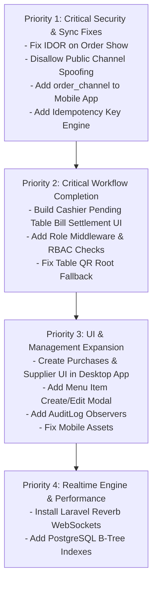

# Production Readiness Audit Report
## Multi-Stall Food Court Management System

**Audit Date:** 2026-11-02  
**Auditor:** Principal Software Architect, Application Security Auditor, QA Architect, and Production Reliability Engineer  
**Repository:** `d:\New folder\Multi-Stall-Food-CourtManagementSystem`  
**Database:** PostgreSQL 17 (`foodcourt_db` / `foodcourt_test_db`)  

---

## 1. Overall Production Readiness Verdict

```
╔═══════════════════════════════════════════════════════════════════╗
║                                                                   ║
║                    OVERALL VERDICT: NOT READY                     ║
║                                                                   ║
║  CRITICAL SECURITY VULNERABILITIES AND WORKFLOW BLOCKERS PREVENT  ║
║            SAFE DEPLOYMENT TO STAGING OR PRODUCTION               ║
║                                                                   ║
╚═══════════════════════════════════════════════════════════════════╝
```

### Verdict Justification:
While the underlying relational schema and multi-stall order splitting mechanics are functional, the system cannot be deployed to production due to four **CRITICAL** defects:
1. **Security Vulnerability (IDOR & PII Leak):** The public endpoint `GET /api/public/orders/{id}` allows unauthenticated attackers to harvest customer names, phone numbers, and dining receipts across the entire food court.
2. **Security Vulnerability (Channel Spoofing):** Any external party can forge orders attributed to cashier POS terminals via `POST /api/public/orders`.
3. **Operational Failure (Mobile App Sync Broken):** The Android waiter app omits `order_channel` in its order payload, causing all waiter and offline orders to fail with HTTP 422 and get stuck permanently in the offline queue.
4. **Workflow Disconnect (Cashier POS Cannot Settle Table Bills):** The desktop POS lacks an interface to query or process payments for pending table orders placed via QR codes or waiters.

---

## 2. Four Applications Readiness Matrix

| Application | Technology Stack | Readiness Status | Summary of Assessment |
|---|---|:---:|---|
| **Backend API** | Laravel 12 / PostgreSQL 17 | **PARTIALLY VERIFIED** | Order splitting, authoritative calculations, and KDS stall isolation work correctly. Major gaps: IDOR on order tracking, unauthenticated channel spoofing, missing role checks on payments/menu edits, missing idempotency, missing Reverb WebSockets (HTTP polling used). |
| **Desktop POS & Admin** | React 18 / TypeScript / Vite | **PARTIALLY VERIFIED** | Production build succeeds (306 kB). Owner dashboard, stall creation, and inventory adjustments work. Gaps: Cashier POS cannot settle existing table bills; no Purchases/Supplier management UI; Menu editing is read-only toggle. |
| **Customer QR Web App** | React 18 / TypeScript / Vite | **PARTIALLY VERIFIED** | Production build succeeds (262 kB). Table browsing, multi-stall cart, and order submission work. Gaps: Exposes order tracking via sequential integer IDOR; visiting root URL without QR code silently binds to Table 1; order submission lacks duplicate-click protection. |
| **Android Mobile App** | React Native / Expo 52 / TypeScript | **FAILED** | TypeScript compiles cleanly with 0 errors. Screens render properly. Fatal defect: Order placement and offline sync omit `order_channel`, causing permanent HTTP 422 failure; `app.json` references non-existent `./assets/icon.png`. |

---

## 3. Comprehensive Findings Ledger

### 3.1 Critical Severity (Blockers for Deployment)

| ID | Application / Module | File Reference | Finding Description | Business / Security Impact |
|---|---|---|---|---|
| **SEC-01** | Backend / API | [`routes/api.php`](file:///d:/New%20folder/Multi-Stall-Food-CourtManagementSystem/backend/routes/api.php#L31), [`OrderController.php`](file:///d:/New%20folder/Multi-Stall-Food-CourtManagementSystem/backend/app/Http/Controllers/Api/OrderController.php#L50) | Insecure Direct Object Reference (IDOR) on `GET /api/public/orders/{id}` without authentication. | Unauthenticated scraping of customer names, mobile numbers, billing amounts, and dining patterns. |
| **SEC-02** | Backend / API | [`OrderController.php`](file:///d:/New%20folder/Multi-Stall-Food-CourtManagementSystem/backend/app/Http/Controllers/Api/OrderController.php#L74) | `POST /api/public/orders` accepts `'order_channel' => 'cashier_pos'` without authentication. | Public attackers can inject fraudulent orders attributed to cashiers, corrupting audit trails. |
| **BIZ-01** | Desktop POS | [`PosPage.tsx`](file:///d:/New%20folder/Multi-Stall-Food-CourtManagementSystem/frontend-desktop/src/pages/PosPage.tsx), [`OrdersPage.tsx`](file:///d:/New%20folder/Multi-Stall-Food-CourtManagementSystem/frontend-desktop/src/pages/OrdersPage.tsx) | Cashier POS has no UI to query `/api/billing/pending` or settle existing orders placed from QR or Waiters. | Food court cashier cannot collect payment or issue receipts for dining table customers. |
| **BIZ-02** | Mobile App | [`NewOrderScreen.tsx`](file:///d:/New%20folder/Multi-Stall-Food-CourtManagementSystem/mobile-app/src/screens/waiter/NewOrderScreen.tsx#L114), [`client.ts`](file:///d:/New%20folder/Multi-Stall-Food-CourtManagementSystem/mobile-app/src/api/client.ts#L42) | Mobile app order payload omits required `order_channel` field. | Waiter orders trigger HTTP 422, get queued locally, and permanently fail to sync to kitchens. |

---

### 3.2 High Severity (Must Fix Before Staging)

| ID | Application / Module | File Reference | Finding Description | Business / Security Impact |
|---|---|---|---|---|
| **SEC-03** | Backend / API | [`MenuController.php`](file:///d:/New%20folder/Multi-Stall-Food-CourtManagementSystem/backend/app/Http/Controllers/Api/MenuController.php#L48) | Menu update checks `$user->stall_id != $item->stall_id` without role check (`isStallManager`). | Kitchen cooks can alter menu item names and dish prices to ₹1. |
| **SEC-04** | Backend / API | [`BillingController.php`](file:///d:/New%20folder/Multi-Stall-Food-CourtManagementSystem/backend/app/Http/Controllers/Api/BillingController.php#L30) | `processPayment` lacks role check (`isCashier` or `isOwner`). | Waiters or kitchen staff can mark orders as paid without cash reaching the counter register. |
| **SEC-05** | Backend / API | [`OrderController.php`](file:///d:/New%20folder/Multi-Stall-Food-CourtManagementSystem/backend/app/Http/Controllers/Api/OrderController.php#L193) | `cancelOrder` has no role restriction and does not check if order is already paid. | Any user can cancel orders; paid orders can be cancelled without refund accounting. |
| **GAP-03** | Backend / API | [`OrderController.php`](file:///d:/New%20folder/Multi-Stall-Food-CourtManagementSystem/backend/app/Http/Controllers/Api/OrderController.php#L71) | Backend does not validate, store, or check `idempotency_key`. | Retried mobile or offline orders generate duplicate parent orders and duplicate kitchen tickets. |
| **BIZ-03** | Customer QR | [`QrMenuPage.tsx`](file:///d:/New%20folder/Multi-Stall-Food-CourtManagementSystem/frontend-customer/src/pages/QrMenuPage.tsx#L61) | Root route `/` without QR token automatically binds customer to Table 1. | Off-premise or walk-in customers mistakenly place orders onto Table 1. |
| **BIZ-04** | Desktop Admin | [`MenuPage.tsx`](file:///d:/New%20folder/Multi-Stall-Food-CourtManagementSystem/frontend-desktop/src/pages/MenuPage.tsx) | Menu management only toggles availability; lacks Create and Edit forms. | Stall managers cannot add new dishes or adjust prices through the desktop app. |
| **BIZ-05** | Desktop Admin | [`Sidebar.tsx`](file:///d:/New%20folder/Multi-Stall-Food-CourtManagementSystem/frontend-desktop/src/components/Sidebar.tsx) | Purchases and Supplier Management screen is missing from desktop UI. | Stall staff cannot create purchase orders or record incoming supplier goods. |

---

### 3.3 Medium Severity (Operational & Performance Risks)

| ID | Application / Module | File Reference | Finding Description | Business / Operational Impact |
|---|---|---|---|---|
| **GAP-01** | Backend / Architecture | `composer.json`, `OrderTrackPage.tsx`, `KdsScreen.tsx` | Laravel Reverb not installed; system uses 4s–5s HTTP polling. | Server CPU and network saturation; delayed notifications. |
| **SEC-07** | Backend / API | [`OrderController.php`](file:///d:/New%20folder/Multi-Stall-Food-CourtManagementSystem/backend/app/Http/Controllers/Api/OrderController.php#L72) | Public orders accept `table_id` directly without validating `qr_token`. | Customers at Table 1 can order food to Table 7 without scanning Table 7's QR. |
| **BIZ-06** | Backend / Audit | [`AuditLog.php`](file:///d:/New%20folder/Multi-Stall-Food-CourtManagementSystem/backend/app/Models/AuditLog.php) | `AuditLog` model and table exist but are never written by any controller. | Zero audit trail for sensitive events (price edits, cancellations, settlements). |
| **BIZ-08** | PostgreSQL Schema | Migrations (`orders`, `order_items`, `stall_kitchen_tickets`) | Foreign keys lack explicit B-tree indexes in PostgreSQL. | Heavy sequential table scans during peak hours and EOD closings. |
| **GAP-05** | Backend / Inventory | Inventory Engine | Sales orders do not automatically deplete inventory raw materials. | Inventory levels require 100% manual adjustments. |

---

### 3.4 Low Severity (Cosmetic & Minor Cleanups)

| ID | Application / Module | File Reference | Finding Description |
|---|---|---|---|
| **BIZ-09** | Database Migration | `daily_closings_and_settlements_tables.php` | Missing composite unique constraint `(closing_id, stall_id)`. |
| **BIZ-10** | Mobile App | `mobile-app/app.json` | References non-existent `./assets/icon.png`. |
| **GAP-06** | Backend / API | `OrderController.php` | Flat 5% GST hardcoded in controller rather than configurable. |

---

## 4. Prioritized Remediation Roadmap

To achieve **PRODUCTION READY** status, fixes must be executed in the following strict order:



### Stage 1: Critical Security & Synchronization Fixes
1. **Fix IDOR on Order Tracking**:
   - Introduce signed `order_tracking_token` or restrict public tracking to `Order::where('uuid', $uuid)` with strict PII masking (never return customer phone numbers publicly).
2. **Eliminate Public Channel Spoofing**:
   - In `OrderController::createOrder`, force `order_channel = 'qr_customer'` for all requests on public routes.
3. **Fix Mobile Waiter App Ordering & Offline Sync**:
   - Add `order_channel: 'waiter_app'` in `mobile-app/src/screens/waiter/NewOrderScreen.tsx` and `mobile-app/src/api/client.ts`.
4. **Implement Backend Idempotency**:
   - Add `idempotency_key` column with unique index to `orders` table. Return the existing order if a duplicate key is submitted.

### Stage 2: Workflow Completion & Access Control
5. **Implement Cashier Pending Table Bill Settlement**:
   - In `frontend-desktop/src/pages/PosPage.tsx`, add a "Pending Table Bills" tab that queries `/billing/pending` and allows one-click bill payment and receipt generation.
   - In `frontend-desktop/src/pages/OrdersPage.tsx`, add a "Collect Payment" action on unpaid orders.
6. **Enforce Strict Role-Based Access Control**:
   - `BillingController::processPayment`: Require `isCashier()` or `isOwner()`.
   - `MenuController::store` & `update`: Require `isStallManager()` or `isOwner()`.
   - `PurchaseController::store` & `receive`: Require `isStallManager()` or `isOwner()`.
   - `OrderController::cancelOrder`: Require `isCashier()` or `isOwner()`, and prohibit cancellation of paid orders without refund.
7. **Fix Customer QR Table Binding**:
   - In `frontend-customer/src/pages/QrMenuPage.tsx`, remove the fallback binding to Table 1. Render a "Please scan an authentic table QR code" prompt if no token is present.
   - Require `'qr_token'` in `POST /api/public/orders` and verify it matches the table.

### Stage 3: Management UI Expansion & Audit Trails
8. **Build Purchase & Supplier Management UI**:
   - Implement `PurchasesPage.tsx` in `frontend-desktop` to create POs, view supplier directory, and receive goods into stock.
9. **Build Menu Item Create / Edit UI**:
   - Add "Add Item" and "Edit Item" modals in `frontend-desktop/src/pages/MenuPage.tsx`.
10. **Automate Audit Logging**:
    - Implement Model Observers on `Order`, `Payment`, `MenuItem`, and `StockMovement` to populate `audit_logs` automatically.
11. **Fix Mobile App Assets**:
    - Create `mobile-app/assets/icon.png` and `favicon.png`.

### Stage 4: Realtime Engine & Performance
12. **Install Laravel Reverb**:
    - Replace HTTP polling with real-time WebSocket events.
13. **Add PostgreSQL B-Tree Indexes**:
    - Add migration with indexes on `(stall_id, status)`, `(payment_status, created_at)`, etc.

---

## 5. Review & Approval Gateway

In accordance with execution boundary rules:
> *No source code modifications were performed during this audit.*  
> *The prioritized remediation plan is submitted for user review before making code changes.*

