# Production Blocker Remediation: Implementation Plan
## Multi-Stall Food Court Management System

**Date:** 2026-11-02  
**Target:** Transform the system from `NOT READY` to a secure, verified, production-ready system suitable for staging deployment.

---

## 1. Remediation Stages & Dependency Sequence

```mermaid
flowchart TD
    S1["Stage 1: Public IDOR & Channel Security<br/>- Migration: tracking_token & idempotency_key<br/>- Public route sanitization<br/>- Channel enforcement"]
    S2["Stage 2: RBAC & Permissions Hardening<br/>- Billing payment restriction (Cashier/Owner)<br/>- Menu price modification restriction (Stall Mgr/Owner)<br/>- Cancellation protection for paid orders"]
    S3["Stage 3: Idempotency & Waiter Channel Fix<br/>- Unique key verification in OrderController<br/>- Add order_channel in mobile app"]
    S4["Stage 4: Mobile Offline Queue Reliability<br/>- Exponential backoff & status states<br/>- Safe restart persistence & manual retry"]
    S5["Stage 5: Cashier POS Pending Table Bills<br/>- Backend GET /billing/pending<br/>- POS Pending Bills drawer & settlement UI"]
    S6["Stage 6: Customer QR Security & Table Binding<br/>- Remove Table 1 fallback on root<br/>- Validate qr_token on order submission"]
    S7["Stage 7: Purchases & Supplier Management UI<br/>- PurchasesPage.tsx in desktop app<br/>- PO creation & stock inward receiving"]
    S8["Stage 8: Menu Item CRUD in Desktop App<br/>- Dish creation & price editing modals"]
    S9["Stage 9: Automated Audit Logging<br/>- Model observers for orders, payments, menu, stock, EOD"]
    S10["Stage 10: Expo Assets & Mobile Config<br/>- Create icon.png, favicon.png, splash.png"]
    S11["Stage 11: Realtime Communication & Broadcasting<br/>- Broadcast events & Echo setup with polling fallback"]
    S12["Stage 12: Database Performance & Indexing<br/>- PostgreSQL B-tree indexes & unique constraints"]
    S13["Stage 13: Comprehensive QA Verification<br/>- Feature, security, idempotency, and build tests"]

    S1 --> S2 --> S3 --> S4 --> S5 --> S6 --> S7 --> S8 --> S9 --> S10 --> S11 --> S12 --> S13
```

---

## 2. Key Architecture Decisions

1. **Public Order Tracking Privacy**:
   - Sequential integer IDs (`/public/orders/{id}`) will be removed.
   - Replaced by cryptographically secure `tracking_token` (`/public/orders/track/{token}`) using `track_` + 40 random alphanumeric characters.
   - Public tracking response masks all customer PII (phone number, customer address) and omits cashier/waiter internal user details.
2. **Channel Spoofing Prevention**:
   - `OrderController::createOrder` will force `order_channel = 'qr_customer'` for any request hitting the public endpoint or without staff authentication.
   - Staff roles (`waiter_app`, `cashier_pos`) require verified Sanctum tokens with role validation.
3. **Server-Side Idempotency**:
   - Add `idempotency_key` (nullable, unique, indexed) to `orders`.
   - If an order with the same key is submitted again, the existing order is returned with HTTP 200 without creating duplicate kitchen tickets.
4. **Cashier Billing for Existing Table Orders**:
   - Cashiers can view all pending table and takeaway orders via `GET /billing/pending`.
   - The cashier can settle the bill and print itemized receipts without recreating the order.
5. **No Business Rules Invented**:
   - Tax remains 5% GST as structured.
   - Settlement formulas remain `settlement_amount = stall_gross_sales` without fabricated deductions.
   - Expense management remains strictly excluded.

